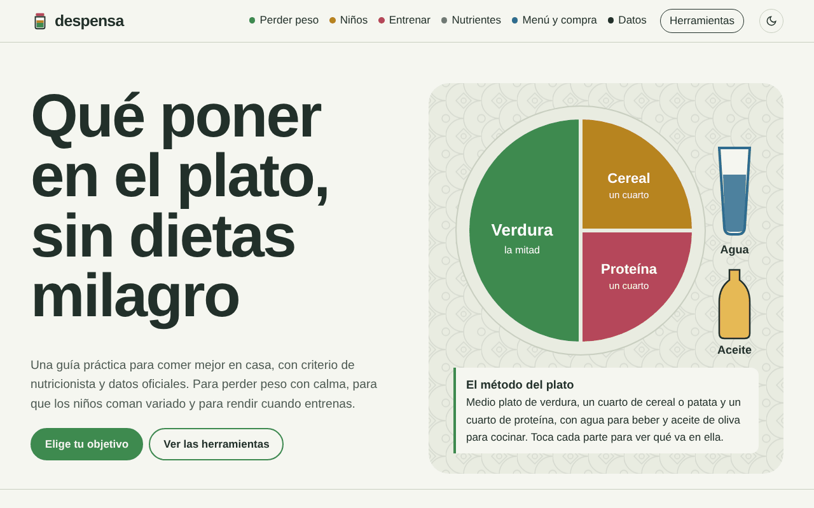
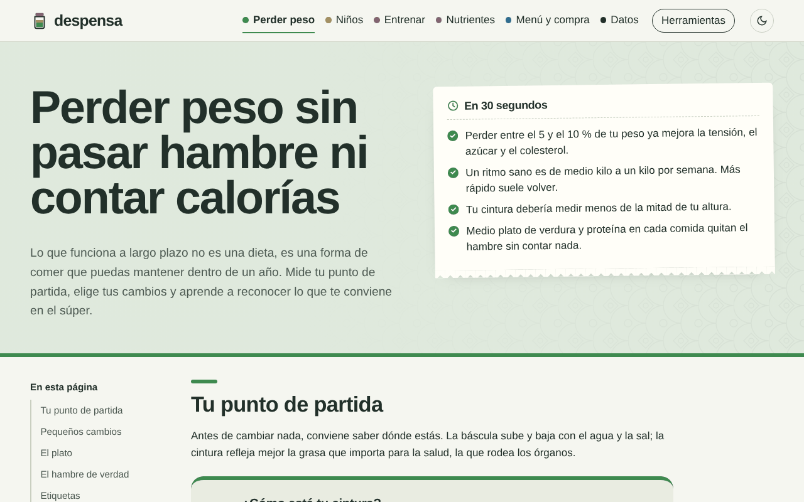
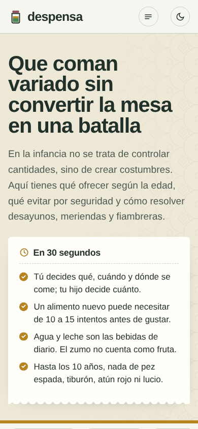
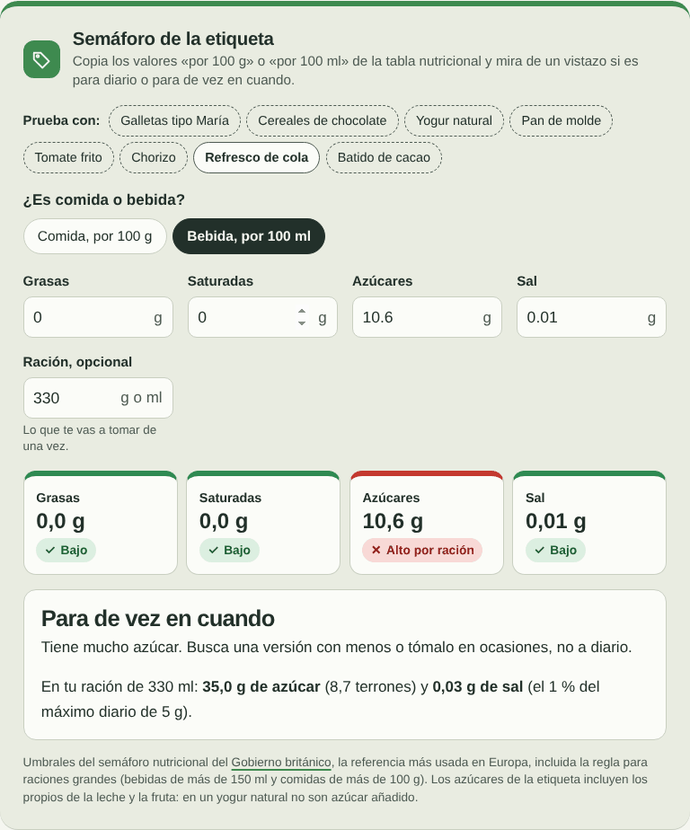
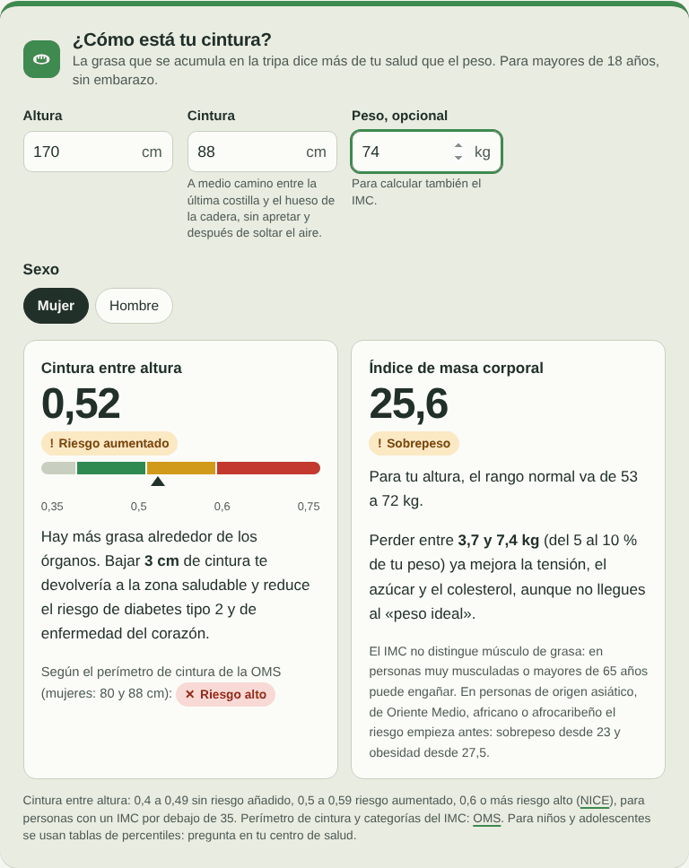
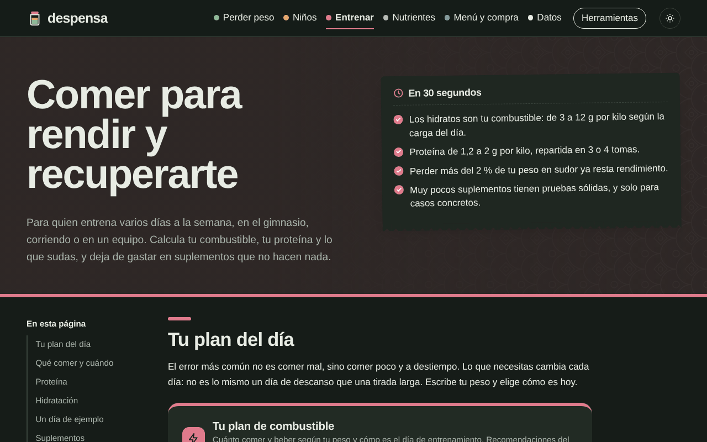

# despensa

Guía práctica de alimentación para toda la familia: perder peso sin dietas milagro, comer bien de pequeños y rendir entrenando. Con herramientas interactivas, datos oficiales y criterio de nutricionista.

**Web:** <https://serbenda.github.io/despensa/>

## Índice

- [Qué es](#qué-es)
- [Recorrido por la web](#recorrido-por-la-web)
- [Herramientas](#herramientas)
- [Rigor y fuentes](#rigor-y-fuentes)
- [Diseño](#diseño)
- [Privacidad](#privacidad)
- [Apoya despensa](#apoya-despensa)
- [Licencia](#licencia)

## Qué es

despensa traduce las recomendaciones oficiales de alimentación (AESAN, EFSA, OMS, sociedades de pediatría y de nutrición deportiva) a decisiones de cada día: qué poner en el plato, qué comprar, qué darle a un niño según su edad o cuánto comer y beber si entrenas.

Está pensada para familias sin formación en nutrición. Por eso cada sección empieza con lo esencial en 30 segundos, sigue con herramientas que responden a tu caso y deja el detalle plegado para quien quiera profundizar.

despensa es divulgativa: no sustituye la consulta con un médico, pediatra o dietista-nutricionista.

## Recorrido por la web

| Página | Qué resuelve | Herramientas |
| --- | --- | --- |
| [Portada](https://serbenda.github.io/despensa/) | El método del plato y la entrada por objetivos: perder peso, niños, entrenar u organizar la semana. Las seis claves con más respaldo científico. | Plato interactivo |
| [Lo básico](https://serbenda.github.io/despensa/basico.html) | Lo que el cuerpo necesita cada día (comer, beber, moverse y dormir), lo que sobra, cómo repartir el día en cinco comidas, desayunos equilibrados por edades, cenas que completan el día y qué beber según la edad. | ¿Qué tomo ahora?, arma tu desayuno |
| [Perder peso](https://serbenda.github.io/despensa/peso.html) | Punto de partida, cambios sostenibles, raciones, hambre real, etiquetas, ultraprocesados, mitos y cuándo pedir ayuda. | Cintura e IMC, pequeños cambios, raciones con la mano, escala del hambre, semáforo de la etiqueta, mito o realidad |
| [Niños](https://serbenda.github.io/despensa/ninos.html) | Reparto de papeles en la mesa, seguridad por edad, raciones, desayunos, fiambrera, el «no me gusta», azúcar, sueño y pantallas, señales para consultar. | Qué puede comer según su edad, raciones con su mano, ideas para la fiambrera, azúcar en terrones |
| [Entrenar](https://serbenda.github.io/despensa/entrenar.html) | Combustible y proteína según el día, qué comer y cuándo, hidratación, un día de ejemplo, suplementos según la evidencia y déficit energético. | Plan de combustible, calculadora de sudor, proteína por ración |
| [Nutrientes](https://serbenda.github.io/despensa/nutrientes.html) | Fibra, calcio, hierro, omega-3 y sal; agua; vitamina D, B12, yodo y folato; embarazo, dieta vegetariana y mayores de 65. | Explorador de nutrientes |
| [Menú](https://serbenda.github.io/despensa/menu.html) | Desayuno, comida, merienda y cena para siete días, en tres pasos: el menú, la lista de la compra donde marcas lo que ya tienes y qué cocinar hoy. Cada plato trae su receta paso a paso y la lista sale con cantidades para los que sois. Cenas ligeras, filtros de alergias y platos que no os gustan. Cada menú cumple las raciones de la AESAN, con los huevos contados en todas las comidas. | Menú semanal con recetas, lista de la compra con cantidades, alergias e intolerancias, ajustar el menú a lo que tengo, ¿qué cocino hoy?, calendario de temporada |
| [Datos](https://serbenda.github.io/despensa/datos.html) | Cómo comemos en España: exceso de peso en adultos y niños, hábitos, renta y cesta de la compra. | Nueve gráficos con tabla y fuente |
| [Herramientas](https://serbenda.github.io/despensa/herramientas.html) | Todas las calculadoras en una sola página. | Todas |

  
  

## Herramientas

Todas calculan al momento, en tu propio dispositivo.

| Herramienta | Qué calcula | Base |
| --- | --- | --- |
| ¿Qué tomo ahora? | Para ocho perfiles (de 1 a 3 años hasta mayores de 65, embarazo y deportistas) y cinco momentos del día: cómo se compone la comida, ideas concretas, qué beber, cuánta agua y en qué fijarse. | AESAN, AEP, EFSA |
| Arma tu desayuno | Combinaciones de cereal integral, lácteo o proteína, fruta y un toque opcional. | AESAN |
| ¿Cómo está tu cintura? | Cintura entre altura con zonas de riesgo (menos de 0,5 sin riesgo añadido; 0,5 a 0,59 aumentado; 0,6 o más alto), perímetro de cintura por sexo e IMC con su categoría, rango de peso normal y lo que supone perder del 5 al 10 %. | NICE NG246, OMS |
| Pequeños cambios | Suma de calorías, azúcar y sal de los cambios elegidos y techo teórico de pérdida de peso en un año: 10 kcal diarias equivalen a unos 450 g a largo plazo, la mitad el primer año. | Modelo dinámico de Kevin Hall (NIH) |
| Raciones con la mano | Palmas de proteína, manos en cuenco de cereal, puños de verdura y pulgares de grasa por comida para mujer, hombre, niño o deportista. | Precision Nutrition, plato saludable |
| Semáforo de la etiqueta | Verde, ámbar o rojo para grasas, saturadas, azúcares y sal por 100 g o 100 ml, regla de raciones grandes y azúcar y sal por ración. Ocho productos de ejemplo. | Guía de etiquetado frontal del Gobierno británico |
| Qué puede comer según su edad | Dieciséis alimentos con estado «evitar», «con cuidado» o «sí» para cinco tramos de edad, de 6 meses a 14 años, con filtro. | AESAN (mercurio, nitratos, cadmio), AEP (atragantamientos), ASPCAT y AESAN (arroz) |
| Ideas para la fiambrera | Combinación aleatoria de base, proteína, verdura y fruta. | Plato saludable |
| Tu plan de combustible | Hidratos al día (3 a 12 g/kg según la carga), proteína (1,2 a 2 g/kg), líquido antes (5 a 7 ml/kg), hidratos por hora durante según la duración y recuperación después. | ACSM, AND y DC 2016; ISSN 2017 |
| ¿Cuánto sudas? | Tasa de sudoración, porcentaje de peso perdido, lo que hay que beber por hora para no pasar del 2 % y cuánto reponer (1,25 a 1,5 l por kilo perdido). | ACSM 2016 |
| Explora los nutrientes | Fibra, calcio, hierro, omega-3 y sal: necesidades, a quién le falta, gráfico por ración frente a la necesidad diaria y consejos. | EFSA, OMS, BEDCA |
| ¿Mito o realidad? | Doce afirmaciones con explicación y marcador. | AESAN, EFSA, OMS |
| Recetas y cantidades | 59 platos con tiempo, ingredientes y pasos. Eliges cuántos sois y la receta y la lista de la compra se recalculan, redondeadas a lo que se compra de verdad. | AESAN 2022 |
| Alergias y gustos | Sin gluten, lactosa, huevo, frutos secos, cacahuete, pescado, marisco, soja o sésamo: esos platos no salen nunca, tampoco en desayunos y meriendas, y las raciones se reparten entre lo que sí podéis comer. Con «No nos gusta» un plato deja de proponerse. | Reglamento (UE) 1169/2011 |
| Cenas ligeras | Los guisos, los arroces y las pastas se quedan a mediodía; por la noche salen cremas, pescado a la plancha, revueltos y ensaladas. | AESAN 2022 |
| Ajustar el menú a lo que tengo | Marcas en la lista de la compra lo que ya tienes (y, si quieres, otras cosas de casa) y el menú se rehace para usarlo primero, repartiendo ingredientes entre platos para que la lista sea más corta y sin saltarse las raciones semanales. Cada plato dice si lo tienes todo o qué falta, y «¿Qué cocino hoy?» propone los seis platos más completos. | AESAN 2022 |

La altura y el peso que escribes en una herramienta pasan a las demás de la misma página, y la web los recuerda para que no tengas que repetirlos.

  
  

## Rigor y fuentes

- **Solo fuentes oficiales o de consenso.** Las recomendaciones salen de organismos públicos y sociedades científicas; los datos de consumo y salud, de estadísticas oficiales.
- **Cifras revisadas.** Todas las cifras, umbrales y fórmulas se contrastaron con su fuente antes de publicarse, con especial atención a la seguridad infantil.
- **Aproximaciones declaradas.** Los valores por ración (proteína, fibra, hierro, calcio, omega-3, sal, azúcar) son aproximados a partir de la BEDCA y de bases internacionales, y la web lo dice junto a cada gráfico.
- **Sin cifras agresivas.** No hay contadores de calorías ni objetivos de peso para niños. La pérdida de peso se presenta como un ritmo sostenible y con avisos sobre cuándo pedir ayuda.

Fuentes principales:

- [AESAN: recomendaciones dietéticas sostenibles y de actividad física (2022)](https://www.aesan.gob.es/AECOSAN/web/noticias_y_actualizaciones/noticias/2022/recomendaciones_dieteticas.htm)
- [AESAN: mercurio en el pescado (2019)](https://maldita.es/malditaciencia/2019/12/22/pescado-y-mercurio-las-recomendaciones-de-la-aesan-actualizan-las-anteriores-y-son-mas-restrictivas-en-los-menores-de-10-anos/), [nitratos y cadmio](https://www.consumer.es/seguridad-alimentaria/contaminantes-alimentarios-nuevas-recomendaciones-sobre-su-consumo.html) y [arroz en la infancia](https://www.consumer.es/?p=608092)
- [AESAN: estudio ALADINO 2023](https://aesan.gob.es/nutricion/datos-sobrepeso-obesidad/aladino-2023)
- [EFSA: valores dietéticos de referencia](https://www.efsa.europa.eu/es/topics/topic/dietary-reference-values), [agua](https://www.efsa.europa.eu/es/efsajournal/pub/1459) y [cafeína](https://www.efsa.europa.eu/en/efsajournal/pub/4102)
- [OMS: alimentación sana](https://www.who.int/es/news-room/fact-sheets/detail/healthy-diet), [actividad física](https://www.who.int/es/news-room/fact-sheets/detail/physical-activity) y [reducción de sal](https://www.who.int/es/news-room/fact-sheets/detail/salt-reduction)
- [NICE NG246: sobrepeso y obesidad](https://www.nice.org.uk/guidance/ng246)
- [AEP: En Familia](https://enfamilia.aeped.es/) y [prevención de atragantamientos](https://aeped.es/sites/default/files/atragantamiento_csvaep_final.pdf)
- [ACSM, AND y DC: nutrición y rendimiento deportivo (2016)](https://pubmed.ncbi.nlm.nih.gov/26891166/) y [ISSN: proteína y ejercicio (2017)](https://pubmed.ncbi.nlm.nih.gov/28642676/)
- [Australian Institute of Sport: marco de suplementos](https://www.ais.gov.au/nutrition/supplements)
- [Gobierno británico: etiquetado nutricional frontal](https://assets.publishing.service.gov.uk/media/5a80cd03ed915d74e33fc7c5/FoP_Nutrition_labelling_UK_guidance.pdf)
- [INE: Encuesta de Salud de España 2023](https://www.ine.es/dyngs/Prensa/es/ESdE2023.htm) y [monográfico de alimentación](https://www.sanidad.gob.es/gl/estadEstudios/estadisticas/encuestaSaludEspana/monografico3_ESdE2023_ResumenEjecutivo.pdf)
- [Mercasa con datos del MAPA: consumo alimentario en los hogares 2024](https://www.mercasa.es/wp-content/uploads/2026/01/datos-basicos-7-consumo-alimentario.pdf)
- [BEDCA: Base de Datos Española de Composición de Alimentos](https://www.bedca.net/)

## Diseño

### La idea

Un mercado y una cocina españolas, no una plantilla. Cuatro elementos dan la identidad:

- **El plato como emblema.** El método del plato es el hilo de toda la web y la pieza central de la portada, servido por partes al cargar.
- **Titulares de cartel de mercado.** Bricolage Grotesque en su anchura estrecha y peso máximo, grande y apretada.
- **Azulejo.** Un patrón geométrico muy suave, solo como textura detrás del plato, en las cabeceras de sección y en las bandas oscuras.
- **El ticket de la compra.** El resumen de 30 segundos de cada sección tiene forma de ticket, con borde dentado y una ligera inclinación.

### Paleta

Cada grupo del plato tiene su color y cada sección hereda uno. El modo oscuro tiene su propia versión de cada tono, no una inversión automática.

| Color | Claro | Oscuro | Uso |
| --- | --- | --- | --- |
| Papel | `#f5f6f0` | `#161c18` | Fondo |
| Tinta | `#22302a` | `#e8ece4` | Texto |
| Hortaliza | `#3e8a4f` | `#6cbf7d` | Verdura · Perder peso |
| Grano | `#b7841f` | `#e2b24e` | Cereal · Niños |
| Proteína | `#b5475a` | `#e07b8c` | Proteína · Entrenar |
| Azulejo | `#2f6c8f` | `#6fa8cc` | Agua · Menú |
| Mineral | `#76559e` | `#b39ddb` | Nutrientes |
| Banda | `#1f2c25` | `#0d1310` | Bandas oscuras y pie |

Los avisos usan verde, ámbar y rojo propios, siempre con texto e icono, nunca solo color. Los colores de las series de gráficos se validaron para daltonismo.

### Tipografía

- **Bricolage Grotesque** (titulares): en su versión estrecha y con mucho peso.
- **Atkinson Hyperlegible** (texto): diseñada para la máxima legibilidad, también para personas con baja visión.

### Piezas que se repiten

- **Cabecera de sección:** banda teñida del color de la sección, con el titular y el resumen.
- **Resumen de 30 segundos:** el ticket con tres o cuatro ideas clave.
- **Índice de la página:** barra lateral en escritorio y fila de pastillas fija en el móvil; marca la parte que estás leyendo.
- **Herramienta:** panel con preguntas, resultado destacado y fuente.
- **Avisos:** etiquetas de «sí», «con cuidado» y «evitar» con icono y texto.
- **Desplegables:** para el detalle que no todo el mundo necesita.
- **Siguiente paso:** cada página termina con la acción recomendada.

### Experiencia de uso

- Cabecera fija y translúcida con una barra de progreso de lectura en el color de la sección.
- En pantallas estrechas, el menú se abre en una hoja lateral con cada sección y su descripción.
- Botón para volver arriba en las páginas largas.
- Accesibilidad: se puede usar entera con teclado, los resultados se anuncian a los lectores de pantalla, cada gráfico tiene su tabla de datos y se respeta la opción de «reducir movimiento».
- Probada en escritorio, en móvil de 390 px y en modo oscuro, sin desbordes.
- Al imprimir se ocultan la navegación y los botones; el menú semanal sale en cuatro columnas.

## Privacidad

despensa no usa cookies, analítica ni formularios, y no pide registrarse. Las herramientas calculan en tu dispositivo: lo que escribes no se envía a ningún sitio. Solo se recuerdan en tu navegador el modo claro u oscuro, tu altura y peso, tu menú semanal, cuántos sois, vuestras alergias, los platos que no os gustan y lo que tienes en casa.

## Apoya despensa

despensa es gratis, sin publicidad y sin registro. Si te resulta útil y quieres que siga creciendo con más herramientas y contenidos, puedes apoyarla en **[GitHub Sponsors](https://github.com/sponsors/serbenda)**.

## Licencia

© 2026 Sergio Santiago Bendaña Quesada. Todos los derechos reservados. Consulta [LICENSE](LICENSE).
